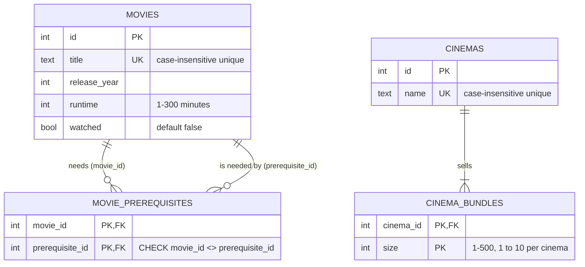

# Doomsday Ready

A small full-stack app that helps MCU fans plan their rewatch before *Avengers: Doomsday* and book an opening-night watch party.

- **Movies & Rewatch Order**: movies with prerequisites, cycle detection (`409 CIRCULAR_DEPENDENCY`), and a topologically ordered rewatch plan with progress and remaining watch time.
- **Cinemas & Booking**: cinemas sell seats in bundles; the quote is the *fewest* bundles that add up to *exactly* the group size.
- **React frontend** with three views: Movies, Rewatch Plan, Booking.

## Run it

### Docker (one command)

```bash
docker compose up --build
```

Open <http://localhost:8080>. The API runs behind nginx at `/api`, data persists in a Docker volume, and the sample data from the brief is loaded on first start.

### Locally (Node 22.13+)

```bash
# terminal 1: API on :3001
cd backend && npm install && SEED=true npm start

# terminal 2: UI on :5173 (proxies /api to :3001)
cd frontend && npm install && npm run dev
```

Tests: `cd backend && npm test` (29 tests: algorithms plus every endpoint and error case).

## Stack

| Part | Choice | Why |
|---|---|---|
| API | Node 22 + Express 5 | small and familiar |
| DB | SQLite via Node's built-in `node:sqlite` | zero setup, real constraints, no native build step |
| UI | React 19 + Vite | simple SPA |
| Packaging | Docker Compose (API + nginx-served UI) | one command |

The only runtime dependency of the API is Express. **No graph or optimisation libraries** are used: all logic for features 1 and 2 is in `backend/src/algorithms/`.

## Data model



Movies form a directed acyclic graph through `movie_prerequisites` (a self-referencing many-to-many). Cycles are prevented in application code, not by the database.

## Algorithms

**Cycle detection** (`algorithms/cycle.js`). Giving movie *M* new prerequisites creates a cycle exactly when *M* is reachable by following prerequisite edges from one of those new prerequisites (or one of them is *M*). An iterative DFS checks this *before* anything is saved; creates and updates run in a transaction, so a rejected change leaves no trace. The error includes the offending path, e.g. `Iron Man -> Endgame -> Infinity War -> Civil War -> The Avengers -> Iron Man`.

**Rewatch order** (`algorithms/rewatch.js`). Iterative post-order DFS from the target: a movie is emitted only after all of its prerequisites, and each movie once (shared prerequisites like Iron Man are not repeated). The target is excluded. Cost is O(movies + links). The response also has `totalMovies`, `watchedCount` and `remainingRuntimeMinutes` (runtime of unwatched movies only).

**Booking quote** (`algorithms/booking.js`). Minimum-coin-change dynamic programming: `best[n] = 1 + min(best[n - size])`, then walk back to count each size. O(groupSize x bundleSizes), at most 100,000 steps. Greedy is wrong here (sizes 6, 9, 20 for 44 seats: greedy takes 20+20 and gets stuck; the answer is 20 + 9 + 9 + 6).

## API

All under `/api`. Errors are always `{ "error": { "code", "message", "details?" } }`.

| Method | Path | Notes |
|---|---|---|
| POST | `/movies` | body `{title, releaseYear, runtime, prerequisites?, watched?}`; also accepts an array |
| GET | `/movies` | list |
| PATCH | `/movies/:id` | any of `title, releaseYear, runtime, watched, prerequisites` |
| GET | `/movies/:id/rewatch-order` | `{target, order[], totalMovies, watchedCount, remainingRuntimeMinutes}` |
| POST | `/cinemas` | body `{name, bundleSizes[]}`; also accepts an array |
| GET | `/cinemas` | list |
| GET | `/cinemas/:id/booking?groupSize=6` | `{possible, totalBundles, bundles:[{size,count}], ...}` |
| POST | `/seed` | extra: loads the sample data into an *empty* database |
| GET | `/health` | extra: used by Docker healthcheck |

Status codes: `201` created, `400` validation (`VALIDATION_ERROR`, `UNKNOWN_PREREQUISITE`), `404` `NOT_FOUND`, `409` `CIRCULAR_DEPENDENCY` / `DUPLICATE_TITLE` / `DUPLICATE_NAME`.

Example:

```bash
curl -X PATCH localhost:3001/api/movies/1 -H 'content-type: application/json' -d '{"prerequisites":[7]}'
# 409 {"error":{"code":"CIRCULAR_DEPENDENCY", ...}}

curl 'localhost:3001/api/cinemas/3/booking?groupSize=44'
# {"possible":true,"totalBundles":4,"bundles":[{"size":20,"count":1},{"size":9,"count":2},{"size":6,"count":1}], ...}
```

## Decisions where the brief was unclear

- **Release year range**: not specified, so I accept 1888-2100 (integer).
- **Prerequisites** may be given as movie ids or exact titles; unknown ones return `400 UNKNOWN_PREREQUISITE`. Duplicates are ignored. Sending `prerequisites` in a PATCH *replaces* the list.
- **Titles and cinema names** are unique case-insensitively (`409 DUPLICATE_TITLE` / `DUPLICATE_NAME`).
- **Bundle sizes** must all be different (the brief says "different bundle sizes"), so repeats are rejected rather than merged. They are stored sorted.
- **Ties in booking**: when several combinations use the same minimum number of bundles, any one is valid; the API returns one of them, largest size first.
- **Impossible booking** returns `200` with `possible: false` and a message (it is a valid answer, not a client error). An invalid or out-of-range `groupSize` is `400`.
- **Batch create**: POST accepts an array and is all-or-nothing.
- **No delete endpoints**: not requested.
- **Sample data**: Doomsday's runtime is a placeholder (150 min) since none is announced; the links are the brief's sample data, not an official guide.

## How I used AI

I used Claude (Anthropic's AI assistant, via Claude Code) to help build this project: scaffolding the Express/React structure, drafting the API validation, the UI, the Docker setup and this README, and writing tests. The algorithms for features 1 and 2 (cycle detection, rewatch ordering, minimum-bundle DP) are hand-written with no libraries solving them, and were checked against every example in the brief by automated tests and a live run. I reviewed the generated code and the design choices listed above.

> **Before you submit:** edit this section so it honestly describes *your* own involvement and what you changed or verified yourself.

## Project layout

```
backend/   src/algorithms/{cycle,rewatch,booking}.js   <- features 1 and 2 logic
           src/services.js  validation + business rules
           src/db.js        SQLite schema + queries
           src/app.js       routes + error handling
           test/            node:test suites
frontend/  src/views/{Movies,Rewatch,Booking}View.jsx
docker-compose.yml
```
